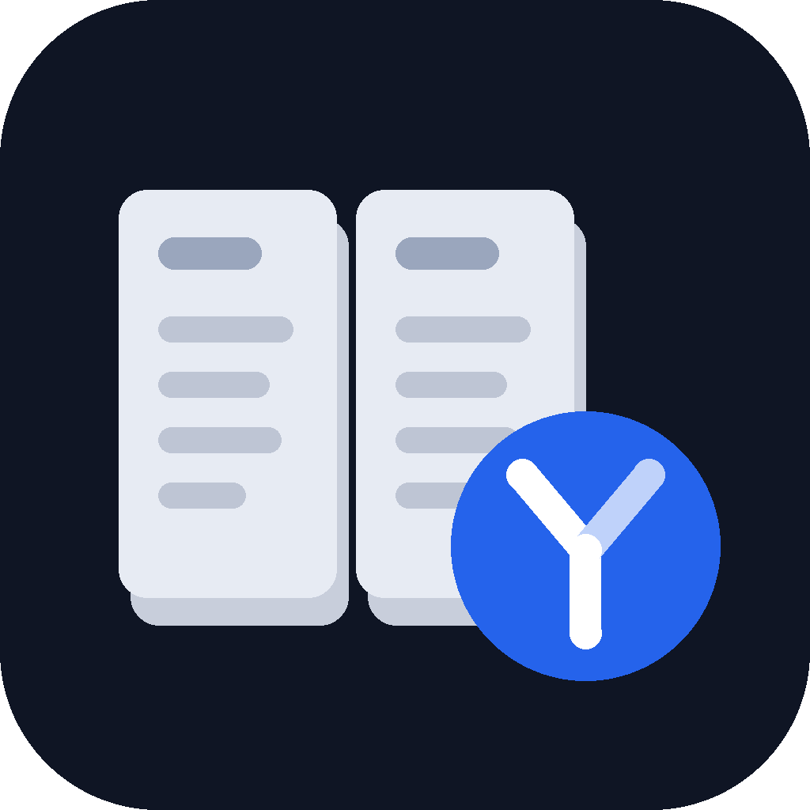

<p align="center"></p>

# Decision Desk

Five decision skills for Claude that work only from what you tell them. Untangle a choice you keep turning over; compare offers, flats, courses or laptops in a weighted matrix where every score says where it came from; get a go or no-go on one thing with the cheapest test first; stress-test a plan before you commit; and rescore when the facts change.

**Try it first:** type *help me decide between* and your two options with what you know about each, or *should I* and the one thing you are weighing.

**The rule of this desk: no fact about your options is invented, the weights are yours to change, and what would flip the answer is always named.** Asked "offer A or offer B?", a plain assistant tends to fill in facts nobody gave it (equity, a bonus, "startups are risky"), to pick the weights silently, and to end with a confident verdict that hides how close it was. Here every fact about an option comes from you; where one is needed and missing you see `[?]`, and a score that rests on a guess says `guess`. The criteria and weights are proposed from what you said and are yours to change; change one and it rescores. Every comparison says in plain words which single change would reverse it, and by how much, or that none would and what comes nearest. You get a recommendation; the decision stays yours.

| Skill | Say | You get |
|---|---|---|
| **decide-frame** | "I can't decide", "I keep going back and forth", "help me think this through" | A decision frame: the decision in one line, by when, what is not being decided now, the real options including *wait*, what is reversible, what is missing and the cheapest way to find it out, and whether it even needs a matrix |
| **decide-compare** | "help me decide between", "offer A or offer B", "which flat should I pick" | A facts table with `[?]` for the gaps, dealbreakers apart from weights, the weighted matrix with a reason and a source for every score, the arithmetic once, what would flip it, a recommendation with a first step you can undo |
| **decide-gonogo** | "should I", "is it worth it", "am I crazy to" | A go/no-go card: gain · lose · reversible? · cost of waiting · cheapest test · yes if · no if · first step, and a recommendation with what would change it |
| **decide-premortem** | "I've decided to", "what could go wrong", "stress-test this plan" | A pre-mortem table of the likeliest causes of failure drawn from your own facts, each with its early sign and what lowers it now, and one kill criterion: the signal at which you should reverse |
| **decide-review** | "rescore this", "the offer changed", "did I make the right call" | Paste a record with what is new: a *what moved* table (was · now · why) and whether the recommendation changed. Or describe a past decision: a look-back card that judges the process, not the luck, with one thing to keep and one to change |

Every reply ends with one **Next:** line: the words to type for the next step, and the skill they reach.

## The decision record

Every skill leaves the same short record in a code block. Copy it somewhere; the desk keeps nothing between conversations. Paste it back into a new chat with what has changed and say *rescore this*.

```
Decision record
decision: which job offer to accept, A or B
deadline: 15 June
options: A: large company | B: 30-person company | wait: ask A for one more week
dealbreakers: none named
criteria and weights (yours to change): learning 5 | commute 4 | pay 2 | security 2 | timing 2
scores: A 45 | B 60   (arithmetic shown above)
flips if: no single change; nearest: B's learning guess at 1 ties it 45 to 45 (clear)
recommendation: B because it leads on commute, your second-heaviest weight; it still leads with both learning guesses at 3
first step (reversible): ask B for its start date in writing before 15 June
chosen: [you fill this]
revisit: [when B gives a start date]
```

`chosen:` is always left for you. When a recommendation rests on a guess, the reply says so and makes checking that guess the first step.

## Where it runs

Everywhere: the Claude apps (web, desktop, mobile), Claude Code and Cowork. No server, no files, no tools; the skills need nothing but the conversation.

## Install

From the Claude directory: search for Decision Desk. In Claude Code:

```
claude plugin marketplace add najikay/claude-decision-desk
claude plugin install decision-desk
```

## Hebrew, Arabic and other languages

The skills answer in the language you write in, tables and labels included, and keep your names, numbers and currency exactly as you gave them. Tables and the decision record sit on their own lines so right-to-left text does not reorder them.

## What it will not do

- Fill in a fact about your options: a salary, a bonus, a start date, a market price, what a company or a city is like. Missing facts are marked `[?]` with the cheapest way to find them out.
- Build a matrix from nothing. Ask "which laptop should I buy?" with no options and it asks what you are choosing between and what matters.
- Decide what needs a professional's reading: a diagnosis, starting or stopping a medication or treatment, what a contract clause means, how something is taxed, which investment or insurance product to buy. It frames the question and the facts to bring to the professional; asked whether to stop a medication, it says to talk to the prescriber or a pharmacist before changing anything. Ordinary choices that involve a contract or money (accepting an offer, signing a lease, buying a car) are decided as usual, with "have the clause read" as the cheapest test when a clause is unclear.
- Weigh a choice that involves hurting yourself or someone else. It answers you and points you to someone to talk to now and to a local emergency or crisis service. Gambling and betting are not this desk either.
- Weigh a decision that belongs to another adult (a partner's job, a grown child's studies) as if it were yours; it helps you frame the conversation instead. Your own decisions that affect others (a young child's school, letting someone go) are weighed as usual.
- Write `chosen:` for you, or pretend to certainty when you say "just tell me". You get the recommendation first, with the flip point and the reminder that it is your call.
- Judge a past decision by its luck, or say you should have known something nobody could have known.
- Put your situation into a web search.

**Research Desk overlap.** Research Desk's `decision-matrix` is for research choices: methods, tools and datasets. Decision Desk is for life and work choices: offers, courses, flats, purchases, moves, projects.

## Tests and evals

EVALS_PLACEHOLDER

## Privacy

A decision usually holds personal data: pay, rent, health, family, an employer's name. See [PRIVACY.md](PRIVACY.md): the plugin collects nothing and adds no recipient; your chat goes only where it always does, to Anthropic under your Claude terms. Give only the facts the decision needs; "company A" and a rounded figure work as well as the real ones.

## Licence

Apache-2.0. Copyright 2026 Naji Kayal.
